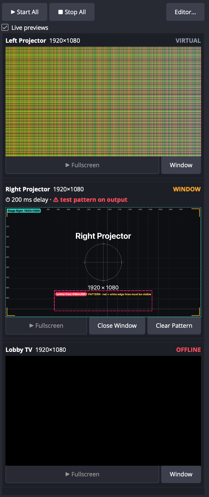

# Output Mapping for OBS Studio

A native OBS Studio plugin for multi-display output mapping. Draw
**slices** on the live Program canvas, assign each
slice to a display (HDMI output), and independently adjust **which part of
Program it grabs** (Input Selection) and **where it lands on the display**
(Output Placement). Every mapped output follows Program live, including
transitions, and runs independently of streaming and recording.

```
Program canvas 3840×1080
┌───────────────────┬───────────────────┐
│     Slice 1       │      Slice 2      │   Input Selection: source crops (Program px)
└─────────┬─────────┴─────────┬─────────┘
          ▼                   ▼
   ┌─────────────┐     ┌─────────────┐
   │   HDMI-1    │     │   HDMI-2    │      Output Placement: destinations (display px)
   │ 1920×1080   │     │ 1920×1080   │
   └─────────────┘     └─────────────┘
```

## Status

| Platform | Status |
|---|---|
| **Windows 10 (2004+) / 11, x64**, OBS 33.0.1 | **Primary target.** Native display layer (`src/platform/platform-windows.cpp`). Builds cleanly in CI (MSVC, warnings as errors); [download it from Releases](https://github.com/Jallison154/obs-output-mapping/releases). **Not yet run on a Windows PC:** please work through [docs/windows-test-plan.md](docs/windows-test-plan.md). |
| macOS 13+ (universal), OBS 33.0.1 | Built and verified end to end; the CI-built installer passes all automated acceptance checks (see [VERIFICATION.md](VERIFICATION.md)). [Download from Releases](https://github.com/Jallison154/obs-output-mapping/releases). |
| Linux | Generic Qt fallback (`platform-qt.cpp`); not built or tested |

Implemented now: rectangular slicing. Corner warping, masks and edge
blending are not yet implemented (the compositor in `src/render/compositor.cpp`
is the place they would go).

## Features

- **Output Mapping dock** in the main OBS window (OBS ▸ *Docks ▸ Output
  Mapping*; shown automatically the first time): a confidence monitor with a
  live thumbnail of exactly what each display receives (including delay and
  test patterns), its status (LIVE / WINDOW / READY / OFFLINE / CHECK /
  VIRTUAL), the frames per second each running output actually draws (or a
  red **⚠ NOT RENDERING** if it stops), ⏱ delay and ⚠ test-pattern markers, per-display **Fullscreen**,
  **Window** and **Clear Pattern** buttons, plus **Start All**, **Stop All**
  (asks first when live), **Test Pattern All** / **Clear All Patterns**
  (asks first when live) and **Editor…**. "Live previews" pauses the
  thumbnails if you need to save GPU; outputs are unaffected. Thumbnails
  refresh about 10 times a second and contain no native video windows, so
  resizing, docking or floating the dock can't disturb OBS or the outputs.

  

- **One editor window** (Tools ▸ *Output Mapping…*): a display and slice
  sidebar, plus two synchronized live previews side by side.
  - **Input Selection** shows the live Program canvas. Click and drag to draw a
    slice. Drag or resize a slice to change which Program pixels it grabs;
    its destination stays fixed.
  - **Output Placement** shows the selected display at its real aspect ratio,
    with its name and resolution, and renders the actual composed video.
    Drag or resize slices there to move them on the display; their source
    crop stays fixed. It is drawn by the same GPU code as the real output.
  - Each slice has the same outline colour in both previews and the sidebar.
    Selection is synced across all three.
  - Sidebar: rename (double-click), duplicate (⌘D), delete, reorder by drag
    or Bring Forward / Send Backward, and reassign to another display (drag,
    context menu, or the *Display* field). **Top of the list is drawn on
    top.**
  - Numeric **X / Y / W / H** fields for the source (Program px) and the
    destination (physical display px), kept in sync with the drag handles.
  - Zoom (mouse wheel, Ctrl/⌘+scroll, pinch, + / −), pan (trackpad
    scroll, Space-drag, middle-drag), Fit (F or double-click), 100% (1).
    Snapping to canvas edges, the centre and other slices (hold Alt/⌥ to
    bypass). Arrow-key nudge (Shift ×10). Optional aspect-ratio lock (hold
    Shift while resizing to toggle it temporarily).
  - **Layout ▾**: show the two previews side by side or stacked (top /
    bottom). *Auto* (default) stacks them when the Program canvas is wider
    than 2:1, which on 3840×1080 more than doubles each preview's size. The
    choice is remembered.
  - **Keyboard commands** (Ctrl on Windows, ⌘ on Mac; full list under
    *Options ▸ Keyboard Shortcuts*): **Copy / Cut / Paste** slices
    (pasting on the same display offsets the copy; on another display it
    keeps the crop), **Paste Position Only** (Ctrl+Shift+V) and **Paste
    Crop Only** (Ctrl+Alt+V) to line slices up exactly, **Tab / Shift+Tab**
    next / previous slice, **] / [** bring forward / send backward, **H**
    show / hide, **F2** rename, **Esc** deselect. Copied slices go to the
    system clipboard, so they paste across presets and OBS sessions.
  - **Identify on the real output** (display panel ▸ *Identify*):
    - **Test Pattern** replaces the output with a calibration image: red
      outermost pixel row and white second row on every edge (if either is
      missing on the screen, it is cropping), 100 px grid with pixel rulers,
      corner markers, centre cross, display name and resolution, and every
      slice's outline at its exact position.
    - **Slice Outlines** draws each slice's outline and name over the live
      video, so you can line it up on the actual screen.
    - Output Placement shows the test pattern too, with the editor's
      draggable outlines on top, so you can fit slices against it.
    - If the display is live, it asks first ("this will take over what the
      audience sees"). A red **ON OUTPUT** badge shows in the sidebar and
      header while it's on. *Test Pattern All* (dock, or *Options ▸ Test
      Pattern on All Displays*) puts it on every display at once, and
      *Clear All Patterns* turns every one off. Identify is never saved: OBS always starts with it
      off. It ignores the output delay so you see changes instantly.
  - **Lock slices** that are set up correctly: tick **🔒 Locked** in the
    slice panel, press Ctrl/⌘+L, or right-click it (or *Lock All Slices* on
    a display). A locked slice can still be selected and inspected, but it
    can't be dragged, resized, nudged, typed into, fit, set to 1:1, deleted
    or moved to another display; reordering it in the list is still allowed.
    The lock is saved with mappings and presets.
  - **Delay** (per display, 0–1000 ms): delays that output's video, e.g. to
    line up displays with different processing latency or to match delayed
    audio. Rounded to whole frames; the editor shows the frame count and GPU
    memory used (1080p ≈ 8 MB per frame). Frames are buffered on the GPU.
    **Changing the delay live never flashes**: the output keeps playing at
    normal speed while the new delay buffers, then crossfades (0.5 s) from
    the old-delay picture to the new one. Turning delay on fades from live,
    and turning it off fades back to live.
    Previews stay live while you edit; the output and snapshots are delayed.
    Audio isn't delayed (use OBS's per-source Sync Offset).
  - **Presets ▾**: save the whole layout (displays, slices, positions)
    under a name and recall it with one click. Recall is live-safe: running
    outputs stay up if the preset still uses their display, the others stop,
    nothing new goes fullscreen by itself, and Undo brings back the previous
    layout. **Import / Export Layout File…** writes a portable `.json` you
    can back up or move between machines. Presets live in the plugin's
    `layouts` folder (*Presets ▸ Open Presets Folder*). "•" next to the
    preset name means you changed something since saving or recalling it.
  - **Undo / Redo** (Ctrl+Z / Ctrl+Y, ⌘Z / ⇧⌘Z) for every edit; a drag or
    a burst of nudges is one step.
  - The *new slices → Display* chip shows where a newly drawn slice will
    go. The sidebar shows each display's state at a glance (READY, LIVE,
    WINDOW, OFFLINE, CHECK, VIRTUAL), and each slice shows 1:1 or scaled.
  - An empty state walks you through adding the first display.
  - **Fit** (to display) and **1:1** (pixel for pixel) actions.
  - Outlines, labels, handles and guides are drawn only in the editor. The
    outputs carry only the composed video.
- **Outputs**
  - Independent **Start / Stop Fullscreen** per display. Several fullscreen
    outputs can run at once, with any number of slices composited per
    display.
  - **Open Window**: a windowed output for testing, or for *virtual* displays
    (a fixed resolution with no monitor attached).
  - **Save Snapshot…**: renders exactly what the display receives to a PNG.
  - **Stop All asks first** when fullscreen outputs are live, so one stray
    click can't black out a show.
  - Hotkeys (Settings ▸ Hotkeys): *Start all fullscreen outputs*, *Stop all
    outputs*, *Open editor*. Also Tools ▸ *Output Mapping: Stop All
    Outputs*.
  - **Esc** stops a windowed output. It stops a fullscreen output only when
    that output covers the screen OBS is on, so you can never get stuck
    behind it. A stray key on a show output on another display does nothing.
  - **Options ▸ Hide outputs from screen capture** (on by default): outputs
    are excluded from Display/Window Capture (Windows
    `WDA_EXCLUDEFROMCAPTURE`, macOS `NSWindowSharingNone`), so Program can
    never contain its own output.
- **Display identity and safety**
  - Displays are identified by the macOS display UUID plus EDID
    vendor/model/serial. A display counts as connected only when it is
    positively identified:
    - **Connected**: exact UUID match.
    - **Connected (re-identified by serial)**: the UUID changed (for example,
      another port), but a unique non-zero EDID serial proves it is the same
      unit.
    - **Ambiguous**: a same-model display is present, but nothing proves it
      is the same one (no serial, or a twin unit). Fullscreen is blocked
      until you pick the display under *Output to*.
    - **Disconnected**: nothing plausible is attached. Fullscreen is
      blocked.
  - If a display is unplugged while live, its output closes immediately,
    before macOS can move the window onto another screen. When *that exact
    display* comes back, the output resumes.
  - Outputs that were running when OBS quit are restored at launch, but only
    on exactly identified displays.
  - A **watchdog** checks every 250 ms (and immediately on Windows
    `WM_DISPLAYCHANGE`) that each fullscreen output still sits exactly on
    its own display. If the OS moved or resized it, it is put back; if the
    display is gone or its identity changed, the output is stopped.
  - On Windows, identity is the DisplayConfig monitor device path (one per
    monitor and connector) plus EDID vendor/product/serial read from the
    registry. Placement uses the monitor's exact physical rect, so 1:1 holds
    at any Windows scaling (125 %, 150 %, 175 %…). If a config file can't
    be read it is set aside rather than overwritten, and a `.bak` of the
    last good file is kept.
- **Persistence**: `~/Library/Application Support/obs-studio/plugin_config/output-mapping/mappings.json`
  (global, independent of scene collections). Hotkeys are stored in
  `hotkeys.json` next to it.
- **Remote control**: obs-websocket vendor `output-mapping`. See
  [Remote control](#remote-control-obs-websocket).

## How it works (OBS APIs)

| Need | OBS 33 API used | Notes |
|---|---|---|
| Live Program frame | `obs_get_main_texture()` (public, `obs.h`) | The main canvas render texture: Program after transitions. libobs renders it every frame whether or not you stream or record, so outputs are independent of both. No desktop capture, and nothing is fed back into Program. |
| Colour handling | Same technique selection as libobs' `obs_render_main_texture()` (`Draw` / `DrawTonemap` / `DrawMultiply`, sRGB-aware sampling) | Outputs look identical to OBS's own projectors. |
| Separate per-display rendering | `obs_display_create()` + `obs_display_add_draw_callback()` on a native Qt widget (`gs_window.view` = `NSView*`) | The same mechanism OBS projectors use. Each output and each editor preview is its own swapchain, rendered on the OBS graphics thread. |
| GPU crop and composite | `gs_draw_sprite_subregion()` with per-slice translate/scale matrices, the default effect, point sampling for exact 1:1 copies and linear for scaled ones | Sources are clipped to the canvas; the clipped part renders black rather than being clamped or stretched. |
| Clipping in the editor | `gs_set_viewport()` limited to the visible canvas, plus a matching `gs_ortho()` | Scissor rects are avoided because their Y origin differs between the GL and D3D/Metal back-ends. |
| Snapshots | `obs_add_main_rendered_callback()` → `gs_texrender` → `gs_stagesurface` | Runs the same `renderDisplay()` as the outputs, inside a real frame. |
| UI | `obs_frontend_add_tools_menu_qaction`, `obs_frontend_get_main_window`, frontend hotkeys, frontend events (`FINISHED_LOADING`, `EXIT`) | |

### Where the public API falls short, and what this plugin does instead

1. **No public Qt display widget.** OBS's `OBSQTDisplay` (and `OBSProjector`)
   live in the frontend and aren't exported to plugins. The plugin carries
   a small equivalent, `src/ui/obs-display-widget.cpp`: a native `QWidget`
   that creates an `obs_display` once exposed and resizes and destroys it
   with the window surface.
2. **No API for "fullscreen on display X" or for display identity.** OBS
   projectors use `QWidget::showFullScreen()` on a screen index, which (a)
   on macOS creates a separate Space per display and fails when *Displays
   have separate Spaces* is off, and (b) uses a screen index that changes
   when displays are re-plugged. The plugin instead:
   - opens a borderless window at the display's exact frame, at
     `NSStatusWindowLevel` (above the menu bar and Dock), joined to all
     Spaces, with no shadow and without activating
     (`src/platform/platform-macos.mm`). This works the same with or
     without separate Spaces;
   - on Windows, uses a `WS_POPUP`, topmost, tool-window HWND that never
     activates, placed with `SetWindowPos` at the monitor's exact physical
     rect (`platform-windows.cpp`), so taskbar, DPI scaling and Windows'
     own fullscreen heuristics don't change its size;
   - identifies displays by OS identity plus EDID vendor/model/serial
     (Windows: DisplayConfig device path and registry EDID; macOS:
     `CGDisplayCreateUUIDFromDisplayID`), and refuses anything ambiguous;
   - holds a display-sleep assertion while any fullscreen output runs.
3. **No public "Program texture" outside the render loop.** Snapshots use
   `obs_add_main_rendered_callback` so they run inside a frame on the
   graphics thread.

Everything else uses public libobs and obs-frontend-api calls. No private
symbols or frontend internals are touched.

## Install on Windows (no build needed)

1. Quit OBS.
2. Go to [**Releases**](https://github.com/Jallison154/obs-output-mapping/releases) and download
   **`output-mapping-<version>-windows-x64.zip`** from the newest release
   (under *Assets*).
3. Right-click the zip ▸ **Extract All…**. You get a folder named `output-mapping`.
4. In File Explorer, paste `C:\ProgramData\obs-studio\plugins` into the
   address bar and press Enter. Create the `plugins` folder if it doesn't
   exist (`ProgramData` is hidden, but typing the path still works).
5. Move the `output-mapping` folder in there, so this file exists:
   `C:\ProgramData\obs-studio\plugins\output-mapping\bin\64bit\output-mapping.dll`
6. Start OBS and open **Tools ▸ Output Mapping…**.

To uninstall, delete that `output-mapping` folder. Every push to `main`
also builds a fresh zip on GitHub Actions (*Actions* tab ▸ latest run ▸
*Artifacts*; requires being signed in to GitHub).

## Install on macOS (no build needed)

Requires macOS 13 or later and OBS Studio 33. The installer is universal
(Apple Silicon and Intel).

1. Quit OBS.
2. From [**Releases**](https://github.com/Jallison154/obs-output-mapping/releases),
   download **`output-mapping-<version>-macos-universal.pkg`**.
3. Double-click it. Because the installer isn't signed with an Apple
   Developer ID yet, macOS first says it can't be opened: click **Done**,
   then open **System Settings ▸ Privacy & Security**, scroll down to the
   message about `output-mapping…pkg` and click **Open Anyway**. (Only
   needed once per downloaded installer.)
4. Click through the installer. It installs only for your user, into
   `~/Library/Application Support/obs-studio/plugins/`, with no admin
   password needed.
5. Start OBS and open **Tools ▸ Output Mapping…**.

To uninstall, delete `~/Library/Application Support/obs-studio/plugins/output-mapping.plugin`.

## Building from source

The first configure downloads the OBS 33.0.1 sources and the matching
prebuilt obs-deps and Qt 6 listed in `buildspec.json`, then builds libobs
and obs-frontend-api into `.deps/`. This is the standard
[obs-plugintemplate](https://github.com/obsproject/obs-plugintemplate)
flow.

### Windows

Requirements: Windows 10/11 x64, Visual Studio 2022 with *Desktop
development with C++*, Windows SDK 10.0.20348 or newer, CMake 3.28+,
Git.

```powershell
git clone https://github.com/Jallison154/obs-output-mapping.git
cd obs-output-mapping
cmake --preset windows-x64
cmake --build --preset windows-x64 --config RelWithDebInfo
cmake --install build_x64 --prefix release --config RelWithDebInfo
```

The last command creates `release\output-mapping\` in your clone. Install
it exactly as in step 5 above.

### macOS

Requirements: macOS 13+, Xcode 16+ (verified: Xcode 27.1), CMake 3.28+.

> **Don't put the build directory in an iCloud-synced folder** (Desktop or
> Documents with iCloud Drive). The File Provider adds
> `com.apple.FinderInfo` to `.plugin` bundles and `codesign` fails. Point
> `-B` somewhere else.

```bash
cmake --preset macos -B ~/Library/Caches/obs-output-mapping/build_macos
```

```bash
cmake --build ~/Library/Caches/obs-output-mapping/build_macos --config RelWithDebInfo
```

```bash
mkdir -p ~/Library/Application\ Support/obs-studio/plugins && ditto ~/Library/Caches/obs-output-mapping/build_macos/RelWithDebInfo/output-mapping.plugin ~/Library/Application\ Support/obs-studio/plugins/output-mapping.plugin
```

### Tests

- **Show-readiness soak test** (`tools/soak_test.py`): runs OBS at 60 fps
  with three outputs for a set time while changing scenes with fades every
  3 s, delay every 7 s, presets every 13 s, test patterns every 17 s and
  nudging slices. It checks every output pixel-exact after each change and
  tracks OBS memory, render time and skipped frames:

  Both test tools run OBS in an **isolated** home (own settings, plugins
  and websocket port 4466, `--multi`), so they never touch your real OBS or
  its settings, even while it is running.

  ```bash
  python3 tools/soak_test.py --obs-app /Applications/OBS.app --work /tmp/omsoak --minutes 30
  ```

- Core unit tests (geometry, display identity rules):
  `output-mapping-core-tests` (built with the plugin).
- End-to-end acceptance test against a real OBS. It uses obs-websocket
  with a random password, creates an "Output Mapping Test" scene
  collection, and restarts OBS once:

  ```bash
  python3 tools/acceptance_test.py --obs-app /Applications/OBS.app --work /tmp/omtest
  ```

  The harness currently launches OBS the macOS way; on Windows, run the
  steps in [docs/windows-test-plan.md](docs/windows-test-plan.md).

## Walkthrough: 3840×1080 Program onto two 1920×1080 displays

1. **Settings ▸ Video**: set *Base (Canvas) Resolution* to `3840x1080`.
   Build your scenes on that canvas.
2. Connect both HDMI displays and set each to its native 1920×1080
   (Windows: *Settings ▸ System ▸ Display*, choose "Extend these displays";
   macOS: *System Settings ▸ Displays*). Avoid "scaled" modes; the editor warns if a
   display is not pixel-exact.
3. Open **Tools ▸ Output Mapping…**.
4. **＋ Display**: pick the first HDMI display, then **＋ Display** again
   for the second. Each appears in the sidebar with a green *Connected* dot
   and its resolution. Rename them by selecting one and editing *Name* (for
   example `Left` / `Right`).
5. Select **Left**. In **Input Selection**, drag from the top-left corner to
   the middle of the bottom edge. Snapping pulls the edges to `0,0` and
   `1920,1080`. A new slice appears, outlined in its colour, with the
   destination `0,0 1920×1080`: 1:1 on Left.
6. Select **Right** and drag over the right half (`1920,0` → `3840,1080`).
   It becomes Right's slice, also at 1:1. Check the numbers in the inspector:
   - Slice 1: Source `0 0 1920 1080`, Dest `0 0 1920 1080`
   - Slice 2: Source `1920 0 1920 1080`, Dest `0 0 1920 1080`
7. Click **▶ Start Fullscreen** for each display, or **▶ Start All** in
   the toolbar. Once a slice is right, tick **🔒 Locked** so it can't be
   knocked out of place. Each display now shows its half of Program.
   Switch scenes in OBS and both outputs follow, including transitions.
8. Fine-tuning:
   - In **Input Selection**, drag a slice to grab a different area. Its
     destination doesn't move.
   - In **Output Placement**, drag a slice to move it on the display. Its
     crop doesn't change.
   - Use arrow keys to nudge by 1 px (⇧ for 10), the X/Y/W/H fields for
     exact values, **Fit to Display** to fill the display, and **1:1
     Pixels** to restore exact pixel scale.
   - To put several slices on one display, draw more slices while that
     display is selected (or drag them onto it in the sidebar). Order them
     in the list; the top one is drawn on top.
9. Quit OBS whenever you like. Mappings and running outputs are restored on
   the next launch, but only on the same physical displays. If one is
   missing, it shows as **Disconnected** (red dot) and nothing is opened on
   another screen. Reassign it under **Output to** if it was replaced.

Without the hardware, use **＋ Display ▸ Virtual Display…** (`1920x1080`)
and **Open Window** to preview each output in a window, or use **Save
Snapshot…** to check pixels.

## Remote control (obs-websocket)

Vendor name `output-mapping`, called via `CallVendorRequest`:

| Request | Data | Effect |
|---|---|---|
| `GetState` | – | Mapping, per-display status and output state, connected screens, Program size |
| `SetState` | `{state}` | Replace the whole mapping (same JSON as `mappings.json`; rects are `{"x","y","w","h"}` objects) |
| `EditorCapture` | `{path}` | Save a screenshot of the editor; the live previews are rendered through their own GPU path |
| `StartFullscreen` / `OpenWindow` / `StopOutput` | `{displayId}` or `{displayName}` | Per-display output control (identity safety checks apply) |
| `StartAll` / `StopAll` | – | All exactly identified displays / all outputs |
| `Undo` / `Redo` | – | Same as the editor buttons |
| `ListPresets` / `SavePreset` / `LoadPreset` / `DeletePreset` | `{name}` | Layout presets, e.g. recall from a Stream Deck |
| `SetDelay` | `{displayName, delayMs}` | Per-output video delay (0 = live); changes crossfade (0.5 s) |
| `SetIdentify` | `{displayName, mode: pattern / outlines / off}` or `{mode: clear}` | Test pattern / slice outlines on an output |
| `SetSliceLocked` | `{sliceName` or `sliceId, locked}` | Lock or unlock a slice |
| `Snapshot` | `{displayName, path}` | Render exactly what the display receives to `.png` / `.ppm` |
| `OpenEditor` / `CloseEditor` / `Select` | … | Editor control |
| `EditorDrag` / `EditorKey` | … | Automation only: needs `OUTPUT_MAPPING_AUTOMATION=1`. Feeds synthetic mouse and keyboard events to the real editor handlers. |

## Source layout

```
src/core/            geometry.hpp (drag/resize/snap/clip math), display-match.hpp (identity rules); pure C++, unit tested
src/model/           mapping document, JSON, immutable render snapshot shared with the graphics thread
src/render/          GPU compositor (slices, overlays, snapshots)
src/platform/        display enumeration and fullscreen windows (macOS .mm, generic Qt fallback)
src/ui/              obs_display widget, output window, interactive preview, editor, theme
src/controller.*     selection, mutations, display status, outputs, persistence
src/plugin-main.cpp  module entry, Tools menu, hotkeys, obs-websocket vendor
tests/               core unit tests
tools/               acceptance test, websocket client, test patterns
```

## Verification

See [VERIFICATION.md](VERIFICATION.md) for exactly what was verified on
which setup, and what still needs testing with real hardware.

## License

The editor's footer and *Options ▸ About Output Mapping* show the version
and copyright. OBS's own Plugin Manager also lists the plugin under its name
and version (from `data/manifest.json`; keep its `version` in step with
`buildspec.json`).

Copyright © 2026 Okami Designs. Released under the GNU General Public License v2.0 or later (see [LICENSE](LICENSE)), as required for plugins linking libobs.
